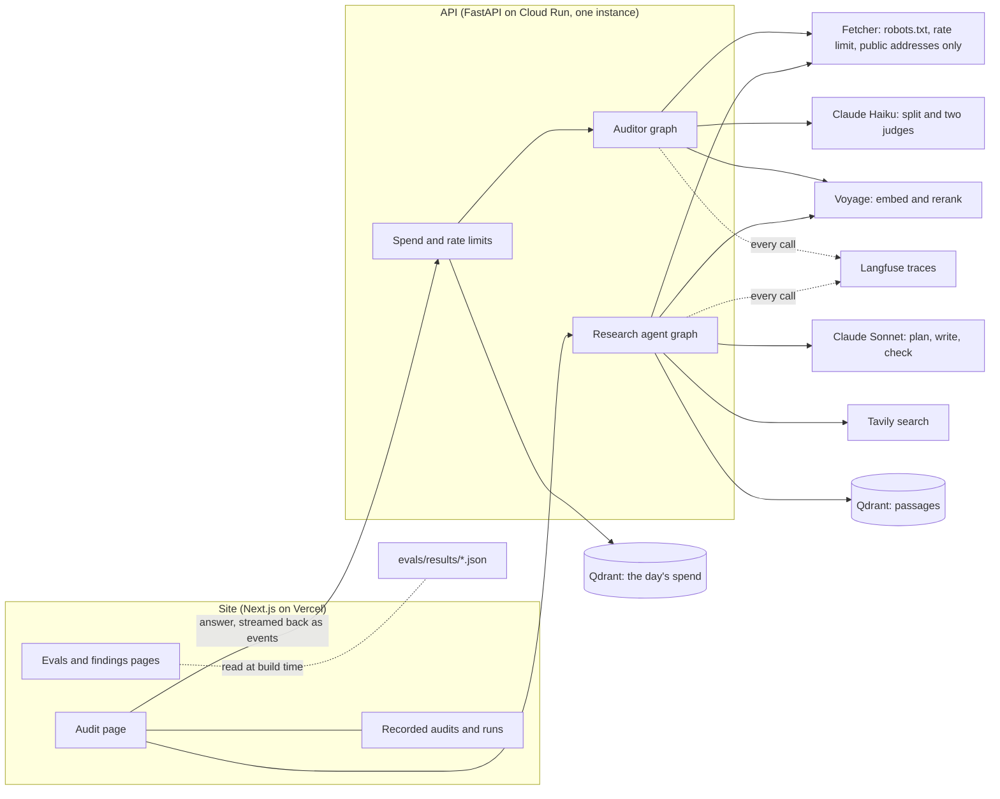

# Evidentia

An auditor for AI answers. Paste an answer with its sources, and Evidentia checks whether each
cited page says what the answer says it does.

Every claim in the answer is checked twice against the page it cites: once against exact quotes
that code has found on the page word for word, and once against the page as a whole. A claim
gets a verdict only when the two checks agree. When they disagree, it is labelled **needs a
human**. Beside every result, the site shows how often the auditor itself is right, measured on
claims that people labelled.

- Site: https://evidentia-green.vercel.app/audit (paste an answer, or watch a recorded audit)
- Every measurement, with intervals: https://evidentia-green.vercel.app/evals
- Decisions behind every part: [`docs/DECISIONS.md`](docs/DECISIONS.md)
- What goes wrong, and when: [`docs/FAILURE_MODES.md`](docs/FAILURE_MODES.md)
- Full evaluation report: [`evals/results/REPORT.md`](evals/results/REPORT.md)

Evidentia began as a research agent that backs each sentence with an exact quote. That agent is
still here, in the second half of this page. Its own evaluation found it no more accurate than
plain RAG, and that result is why the project turned to auditing (D-034).

<!-- results:start (written by `python -m evals report`; do not edit by hand) -->

## Results at a glance

Every number in this section is written by code from `evals/results/`. The website's Evals page reads the same files.

### The auditor, against people's labels

1,100 rows of LLM-AggreFact that were never used to tune it. 0.500 balanced accuracy is a guess.

| Measure | Value | 95% interval |
|---|---|---|
| Flags right (marked not on the page or contradicted) | 0.806 | 0.767 to 0.844 |
| Supported marks right | 0.926 | 0.897 to 0.951 |
| Balanced accuracy, on claims with a verdict | 0.754 | 0.725 to 0.783 |
| Claims given a verdict (the rest go to a person) | 0.823 | 0.801 to 0.845 |

Source: `evals/results/aggrefact_pooled-dev550b+test2_q-haiku_p-haiku.json`.

### The auditor on real answers: blind hand checks

A person checked samples of its verdicts on two AI search tools' answers against the live pages, blind to the tool and the verdict. The bar, set before any label: 70% of flags upheld. It was not met, so the tools are not compared.

| Hand check | Claims | Flags upheld | 95% interval | Supported upheld | Bar met |
|---|---|---|---|---|---|
| First, before the fix (D-044) | 40 | 54%, 7 of 13 | 29% to 77% | 16 of 19 | no |
| Second, after the fix (D-049) | 21 | 69%, 9 of 13 | 42% to 87% | 4 of 4 | no |

Source: `evals/results/realworld_hand_check.json`, `realworld_hand_check_2.json`.

### Search: recall and precision at k

40 questions over 2,362 passages from 50 saved pages, mostly Wikipedia. R@k is the share of relevant passages in the top k; P@k is the share of the top k that is relevant. A question has 2.5 relevant passages on average, so no ranking can reach 1 on every measure: the last row is what a perfect ranking would score.

| Retriever | R@1 | R@3 | R@5 | R@10 | P@1 | P@3 | P@5 | P@10 | MRR@10 | nDCG@10 |
|---|---|---|---|---|---|---|---|---|---|---|
| Keyword only (BM25) | 0.192 | 0.350 | 0.442 | 0.571 | 0.400 | 0.258 | 0.200 | 0.133 | 0.533 | 0.454 |
| Dense only | 0.283 | 0.592 | 0.775 | 0.917 | 0.575 | 0.450 | 0.370 | 0.223 | 0.739 | 0.751 |
| Hybrid (dense + BM25) | 0.254 | 0.475 | 0.667 | 0.867 | 0.525 | 0.367 | 0.310 | 0.210 | 0.669 | 0.672 |
| **Dense + rerank (shipped)** | 0.338 | 0.658 | 0.817 | 0.938 | 0.700 | 0.508 | 0.395 | 0.230 | 0.816 | 0.804 |
| Hybrid + rerank | 0.338 | 0.658 | 0.817 | 0.938 | 0.700 | 0.508 | 0.395 | 0.230 | 0.817 | 0.804 |
| Best possible | 0.454 | 1.000 | 1.000 | 1.000 | 1.000 | 0.825 | 0.495 | 0.247 | 1.000 | 1.000 |

Intervals (95% bootstrap over questions, 2000 resamples) are in `evals/results/REPORT.md`. Source: `evals/results/retrieval.json`.

### The research agent, against plain RAG

40 questions on the same saved pages. A separate judge (claude-opus-5-5) checked whether each claim's evidence backs it.

| System | Claims shown as backed that are fully backed | Characters to read | Cost per question |
|---|---|---|---|
| Plain RAG, Sonnet | 0.917 (0.877 to 0.953) | 1039 | $0.0141 |
| Evidentia before tightening | 0.928 (0.895 to 0.961) | 195 | $0.0401 |
| **Evidentia (shipped)** | 0.925 (0.901 to 0.948) | 188 | $0.0491 |

| Checker model | Broken claims caught | Agreement with a second model | Cohen's kappa |
|---|---|---|---|
| **claude-sonnet-5-5 (shipped)** | 49 of 50 | 0.893 (0.840 to 0.940) | 0.829 (0.744 to 0.903) |
| claude-haiku-5-5 | 48 of 50 | 0.900 (0.853 to 0.947) | 0.838 (0.753 to 0.913) |
| claude-opus-5-5 | 50 of 50 | 0.880 (0.827 to 0.927) | 0.809 (0.723 to 0.885) |

Agreement is with a stronger model from the same family, not with a person.

- Hostile pages passed: hidden instructions in a page 5 of 5, a paywalled page 5 of 5, two pages that disagree 5 of 5.
- Questions the pages cannot answer, where the system made no claim: Plain RAG, Sonnet 20 of 20, Evidentia 20 of 20, Plain RAG, Haiku 19 of 20, Evidentia, all Haiku 20 of 20.

Source: `evals/results/citation_accuracy.json`, `checker_agreement.json`, `unanswerable.json`, `nasty.json`.

<!-- results:end -->

## Architecture



The auditor, step by step:

```
parse (code) → split (Haiku) → fetch (code) ┬→ find quotes (Haiku) → exact-span check (code) → check the quotes (Haiku) ┬→ combine (code)
                                             └→ page judge (Haiku) ────────────────────────────────────────────────────┘
```

## How an audit works

On the site's Audit page, or with `python -m evidentia audit answer.md`. The answer can use
markdown links, bare addresses, or numbered markers like `[1]` with a source list, whether the
list is on separate lines or has lost its line breaks in the paste.

1. **Parse (code).** Finds every citation and where it sits in the answer.
2. **Split (Claude Haiku).** Breaks the answer into claims. Code checks that each claim's
   sentence is really in the answer, and code decides which pages it cites.
3. **Fetch (code).** Evidentia's own fetcher downloads each cited page. It obeys robots.txt,
   waits between requests to the same site, and connects only to public addresses, checked
   after DNS resolution. PDFs are read page by page.
4. **Two judges, at the same time, both Claude Haiku:**
   - **Quote judge.** Finds up to five quotes on the cited page that back or contradict the
     claim. Code checks that each is an exact span of the page. A separate call then sees only
     the claim and the quotes.
   - **Page judge.** Sees the claim and the page, and says whether the page supports it.
5. **Combine (code).** A claim gets a verdict only when the two judges agree. Otherwise it is
   labelled **needs a human**, with both judges' reasons.

The labels are:

| Label | Meaning |
|---|---|
| supported | both judges agree the cited page states the claim |
| partial | the page backs the main point but not every detail; never counted as a failure |
| contradicted | the page says something that cannot be true along with the claim |
| not on the cited page | both judges agree the page does not state it |
| needs a human | the two judges disagree |
| dead link | the address answers 404 or 410, or its name does not resolve |
| could not check | the page was not read: robots.txt, a refusal, too little text, a time-out |
| could not read the citation | the sentence has a marker such as `[7]`, but no source matches it |
| uncited | no citation in the sentence or its paragraph |

A sentence with no citation of its own takes the one that closes its paragraph, and is marked as
cited that way.

Long pages are cut to the passages Voyage's reranker ranks highest. A page cited by several
claims is sent as a cached prompt prefix, so later claims about it read it cheaply.

Haiku is used for the judges because, on 550 practice rows, Sonnet was no better and cost 15
times as much per claim (`evals/results/aggrefact_dev550_q-sonnet_p-sonnet.json`).

### How the auditor compares with people's labels

LLM-AggreFact pairs claims with documents, each labelled supported or not by people.

**First version (D-037): one judge, quotes only.** On 550 of its test rows (50 from each of 11
sub-datasets), with Claude Haiku:

| System | Balanced accuracy | When it says supported, right | Supported rows it accepts | Unsupported rows it rejects |
|---|---|---|---|---|
| Auditor (exact quotes, then a check on the quotes alone) | 0.688 (0.646 to 0.728) | 0.915 | 0.523 | 0.916 |
| Plain yes/no on the whole document | 0.768 (0.721 to 0.811) | 0.910 | 0.730 | 0.876 |

That version agreed with people less than a plain yes/no did (difference −0.080, from −0.120 to
−0.038). It was stricter, not looser: it turned down about half the claims people accept.

**Current version (D-038 to D-040): two judges.** It was tuned on 550 practice rows from the
benchmark's dev split, then measured on 1,100 rows never used to tune it: 550 more dev rows
and 550 test rows (`evals/results/aggrefact_pooled-dev550b+test2_q-haiku_p-haiku.json`).
Partial is counted as its own verdict, not as a failure.

| On 1,100 untouched rows | Flags right | When it says supported, right | Claims with a verdict |
|---|---|---|---|
| Two judges | 0.806 (0.767 to 0.844) | 0.926 (0.897 to 0.951) | 0.823 |
| Quote judge alone | 0.560 | 0.913 | 1.000 |
| Page judge alone | 0.681 | 0.918 | 1.000 |

For a single judge, "flags" means every claim it does not call supported.

- **Two judges beat either one alone.** About 81 of every 100 flags are right, against 68 for the
  better single judge. The price is that 18% of claims get "needs a human" instead of a verdict.
- **A finish line was set before the test run** (flags right at least 0.80, supported right at
  least 0.93). On the 550 test rows alone it was missed: 0.773 and 0.910
  (`aggrefact_test2_q-haiku_p-haiku.json`). On the 550 dev rows it was met. Three samples of 550
  rows gave flags right of 0.810, 0.839 and 0.773, so a single sample of that size cannot settle
  a bar this close. The pooled figures above are the better estimate, and both bars lie inside
  their intervals.
- **What else was tried, and dropped by rules set in advance.** Sonnet as the judges, a judge from
  OpenAI, more votes, token probabilities, quote context, extra checker rules, and a graded page
  judge. None held up on rows it had not been tuned on (`docs/DECISIONS.md`, D-038 to D-040).
- **About partial.** On 18% of claims, both judges agree a detail is not stated. The benchmark's
  labellers accepted about half of those. No person checked them for this project, so partial is
  reported apart and never counted as a failed citation. That way, a count of failures is a
  lower bound either way.

Cost: $0.00069 per claim for both judges together.

Full tables: `evals/results/REPORT.md`.

### The real-world audit, and the hand checks it has not yet passed

OpenAI's `gpt-6.2-sol` and Claude Sonnet 5.5, each with web search on, answered the same 100
fixed questions, and Evidentia audited every answer (D-042 to D-049). Before publishing a
comparison, Aditya checked blind samples of the auditor's verdicts against the live pages. He saw
each claim and its cited page, and not which tool wrote it or what the auditor said. The rule,
fixed before any label: at least 70% of the flags he can settle must be upheld, or the tools are
not compared. Both checks' figures are in "Results at a glance" above.

- **What the first check found.** Most of the flags he rejected had their evidence on the page,
  in a header date, a caption or a stat box, but the page reader kept only the article, so the
  judges never saw it.
- **The fix (D-049).** The auditor now reads the rest of the page after the article, still as the
  page's own text, so quotes are still checked word for word. The saved answers were audited again
  and the second check was drawn from those audits, leaving out every sentence he had
  already seen.
- **The second check missed the bar by one flag.** The bar is not moved after the labels, so
  neither this README nor the site compares the tools. The second check had 17 flags because
  Claude had only 7 unseen flags left to draw, and he was unsure on 4 of them.
- **Why the second check's 4 rejected flags happened** (D-049): two were a name the answer gave
  that the page never uses, one was a 144-page PDF whose evidence sat past the 40 pages read, and
  one was a judge misreading the page. A fix for the PDF case was drafted (D-050) and parked: it
  touches few flags and cannot change the result above.

The questions, answers, both sets of audits, the labels and every figure are in
`evals/realworld/` and `evals/results/realworld*.json`, including the per-tool figures that are
not compared here.

## The research agent

Ask a question. Evidentia searches the web, reads the pages (HTML and PDFs), and writes short
claims. Each claim carries a quote copied from a page. Code checks that the quote is on the page
word for word, and a separate model, shown only the claim and the quote, judges whether the
quote backs the claim. Each claim ends up labelled **supported**, **partial** or **unverified**.

```
plan → search → fetch → index → retrieve → write → quote check → check
                                                                   │
                     failed claims: new query → search the pages again → rewrite → check again
```

1. **Plan.** Claude Sonnet writes a few web search queries.
2. **Search and fetch.** Tavily returns addresses; Evidentia's own fetcher downloads them. It
   obeys robots.txt, waits between requests to the same site, and connects only to public
   addresses, checked after DNS resolution. PDFs are read page by page, so a quote from a PDF is
   cited to its page.
3. **Index and retrieve.** Pages are cut into passages, embedded with Voyage, stored in Qdrant,
   and reranked with Voyage's reranker.
4. **Write.** Sonnet writes claims, each with a quote and the source it came from. Page text is
   passed to the model inside marked data blocks and treated as data, never as instructions.
5. **Quote check (code).** A quote counts only if it is an exact span of the stored page text.
6. **Check (model).** An independent checker sees only the claim and the quote.
7. **Repair.** A claim that fails gets one more try: a new query, a fresh look through the
   fetched pages, and a rewrite, which is checked again from the start.

Every run has a hard cost cap in code and records tokens and dollars per step. Every model and
tool call is traced in Langfuse.

### What the research agent's evaluation found

Run on a frozen set of 50 openly licensed pages (mostly Wikipedia) and 40 questions. These pages
are cleaner than the open web, so real use would likely score lower. All numbers below are
copied from `evals/results/`, with 95% intervals.

The figures are in "Results at a glance" above. What they say:

- **Accuracy is not better than plain RAG.** The intervals overlap. What the pipeline adds is
  evidence you can check quickly (a short quote instead of a whole passage) and a checker that
  catches mistakes, at a higher cost.
- **The checker catches broken claims.** Claims were broken on purpose (wrong quote, one fact
  changed, or a detail added), and each checker model refused nearly all of them.
- **Keyword search did not help retrieval here.** Dense search alone beat dense plus BM25 before
  reranking, and after reranking the two were equal, so BM25 is off in the shipped search.
- **The reranker earns its place.** It lifts every cut-off, most of all precision at 1.
- **Hand-made attacks** (hidden instructions in a page, paywalled pages, contradictory pages)
  all passed. That covers these cases only; it is not a security guarantee.

**Not done.** No person has labelled the checker's verdicts, so there is no agreement-with-a-human
figure; the only agreement figure is with a second model, which says little about correctness.

## Running it

Needs Python 3.11+, [uv](https://docs.astral.sh/uv/), and Node 22 for the site. Keys come from
environment variables: `ANTHROPIC_API_KEY`, `TAVILY_API_KEY`, `VOYAGE_API_KEY`, `QDRANT_URL`,
`QDRANT_API_KEY`, `LANGFUSE_PUBLIC_KEY`, `LANGFUSE_SECRET_KEY`. `OPENAI_API_KEY` is needed only
for the real-world audit and for recording new audits.

```
uv sync
uv run python -m evidentia audit answer.md
uv run python -m evidentia "How fast did global solar capacity grow in 2023?"
```

The first line audits an answer saved in a file, for about a cent. The second runs the research
agent. Both cost money (model, search and embedding calls) and stop at the caps set in
`evidentia/config.py`.

The site and the API:

```
uv run uvicorn evidentia.api:create_app --factory --port 8000
cd web && npm install && npm run dev
```

Tests and lint, no keys or money needed:

```
uv run pytest
uv run ruff check .
```

The evaluations are under `uv run python -m evals`. They make many model calls; see D-021 in the
decisions file before running them. `uv run python -m evals report` rebuilds the report from the
saved results for free.

Deployment (Cloud Run for the API, Vercel for the site) is in [`docs/DEPLOY.md`](docs/DEPLOY.md).

### What keeps the public site from running up a bill

- A hard cost cap on every run, audit and check, enforced in code before each model call.
- Per-address limits on runs, audits and checks per day, held in memory.
- A daily budget across all visitors. The day's spend is stored in Qdrant (D-051), so a restart
  of the server does not reset it; if it cannot be read, live runs are refused.
- One server instance, so the limits are counted in one place.

## Layout

| Path | What it is |
|---|---|
| `evidentia/` | The pipeline, the fetcher, the quote check, the API |
| `evidentia/audit/` | The auditor for other tools' answers |
| `evals/` | The evaluation: corpus, questions, runs and results |
| `tests/` | Tests; they use fakes and make no paid calls |
| `web/` | The site (Next.js) |
| `docs/` | The plan, the decisions, the deployment steps |

## Not supported

Video and charts. YouTube's robots.txt disallows the addresses captions come from (D-032), and a
number read off a chart by a model has no exact text to check (D-033).

## Credits

Rebuilt in 2026 by Aditya Kanbargi. The first version of Evidentia (2025), by Aditya Kanbargi and
Sanjana Kadambe Muralidhar, is kept in the git history.

MIT licence; see [`LICENSE`](LICENSE).
